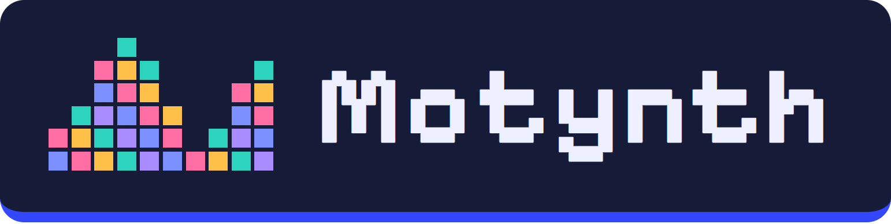
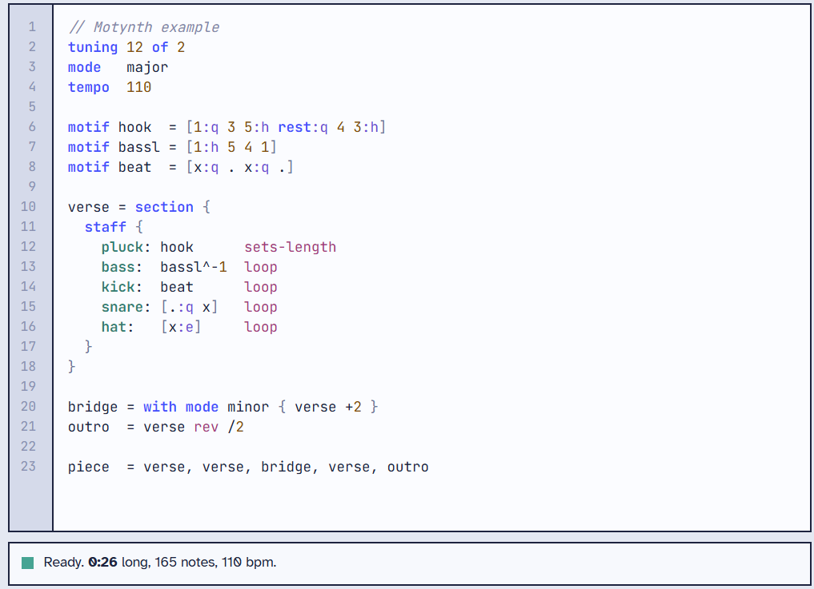
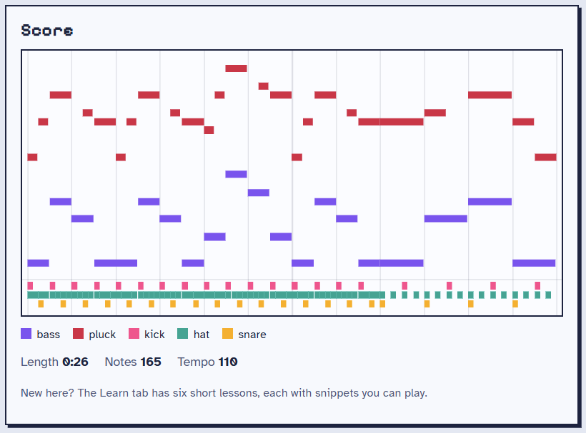
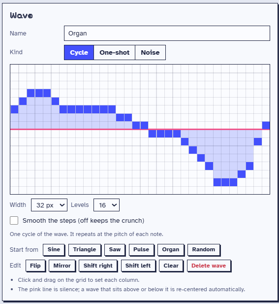
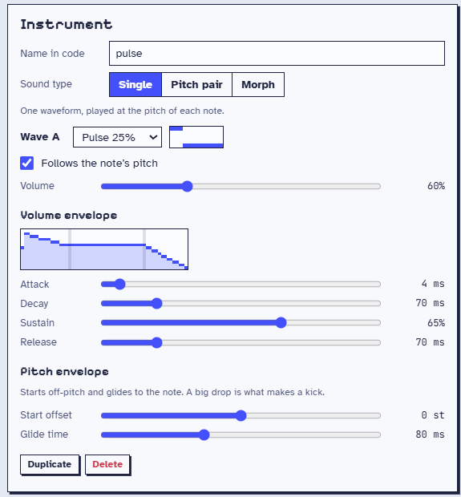

<h1></h1>

A small music composition tool built around two ideas: **synth** and **motif**.

- **Sounds are drawn.** You paint single-cycle waveforms on a pixel grid (8 to 64 columns, 2 to 16 levels), then build instruments from them. The limits are deliberate: the crunch is the charm.
- **Music is text.** A tiny language lets you name notes, motifs, sections and whole pieces, and combine them with scopes (tuning, mode, tempo) and modifiers (transpose, reverse, fit, loop).

Everything runs in the browser with the Web Audio API. It is written in TypeScript, with a React interface, and built with Vite.

**Try it:** <https://crunchbangle.github.io/motynth/>

<p>
  
  
</p>

## Develop

You need Node 24 (see `.nvmrc`).

```
npm install
npm run dev          # serve the app with live reload
npm run check        # formatting, type check and tests: what CI runs
npm run build        # build the site into dist/
```

| Script | What it does |
| --- | --- |
| `npm run dev` | Serves `app/` at a local address with live reload |
| `npm test` | Runs the tests once (Vitest); `npm run test:watch` keeps running them |
| `npm run test:e2e` | Builds the site and tests it in a real browser (Playwright) |
| `npm run typecheck` | Type-checks everything with `tsc` (strict) |
| `npm run format` | Formats with Prettier; `format:check` only checks |
| `npm run build` | Builds the site into `dist/` |
| `npm run preview` | Serves the built `dist/` |

Fonts load from Google Fonts (Pixelify Sans, Atkinson Hyperlegible, JetBrains Mono) and fall back to system fonts offline.

Your code and sounds are saved in the browser's `localStorage`. Sounds saved by the original prototype are converted the first time the app loads.

## Tests

There are three layers:

- **Unit and parity tests** (`test/`, Vitest) for the engine, sounds and audio maths. Many compare the app with the original prototype in `prototype/motynth.html`, which is never edited, by loading the prototype's own code:
  - The engine gives identical results (notes, times, frequencies, error messages and positions) on every lesson and example, about 90 edge cases, 600 random programs and a randomly corrupted copy of each (`test/parity.test.ts`).
  - Wave buffers match sample for sample, and envelopes point for point (`test/sound/`).
  - Syntax highlighting, the piano roll and the wave and envelope pictures produce the same output and the same canvas drawing calls (`test/ui/`).
- **Component tests** (`test/ui/*.test.tsx`, Vitest with Testing Library in jsdom) render the React tabs with a fake player and in-memory storage, and use them as a person would.
- **Browser tests** (`e2e/`, Playwright) run the production build in real Chromium: real Web Audio, canvas, storage and reloads. They fail on any console error. To run them the first time, install the browser with `npx playwright install chromium`, or set `PLAYWRIGHT_CHANNEL=msedge` (or `chrome`) to use one you have.

Vitest tests use the global `test` and `expect` rather than importing them: on Windows, importing `vitest` from a working directory with a lowercase drive letter (as VS Code uses) loads it twice and finds no tests.

Audio quality can't be tested automatically; listen when you change sound code.

## Deploy

`.github/workflows/ci.yml` runs on every push and pull request: formatting, type check, tests, build, then browser tests. On a push to `main`, if all of that passes, it deploys `dist/` to GitHub Pages. If the browser tests fail, the run has a `playwright-report` artifact with traces.

## The app

| Tab | What it does |
| --- | --- |
| Compose | Code editor, live error checking, piano-roll score with playhead, example menu |
| Sounds | Pixel wave editor, instrument editor, test bar that plays a motif after every change |
| Learn | Six lessons with playable snippets, plus a language reference |

## Sounds

- **Wave kinds:** cycle (looped, follows pitch), one-shot (plays once, pitched by playback rate against a reference pitch), noise (white, or a short metallic LFSR pattern).
- **Instrument types:**
  - *Single:* one wave.
  - *Pitch pair:* two waves with reference pitches, crossfaded by note pitch.
  - *Morph:* wave A blends toward wave B over the note, driven by its own attack/decay/sustain/release envelope.
- **Envelopes:** volume ADSR, morph ADSR, and a pitch envelope (start offset plus glide time) for kicks and toms.
- **Follow pitch:** turn it off and the instrument always plays at its reference pitch (drums).

<p>
  
  
</p>

## The language in one screen

```
tuning 12 of 2            // notes per register, and the register ratio
mode   major
tempo  110
root   261.63             // Hz of degree 1

motif hook  = [1:q 3 5:h rest:q 4 3:h]   // degrees; durations stick until changed
motif bassl = [1:h 5 4 1]
motif beat  = [x:q . x:q .]              // x = percussion hit, . = rest

verse = section {
  staff {
    pluck: hook       sets-length         // this block decides the section length
    bass:  bassl^-1   loop                // repeat until the section ends
    kick:  beat       loop
    hat:   [x:e]      loop
  }
}

bridge = with mode minor { verse +2 }     // scoped mode, tonal shift of two degrees
outro  = verse rev /2                     // backwards, half speed

piece  = verse, verse, bridge, verse, outro
```

Key points:

- **Pitch literals** are never frequencies. `3` is a degree of the current mode, `n7` is a step of the tuning, `3#` and `3b` nudge a degree by one step, and `names [...]` lets you write note names.
- **Durations** are exact fractions of a whole note: `w h q e s t`, a trailing `.` for dotted, and `*2/3` for triplets.
- **Modifiers** go after any motif, section or name: `+2` (tonal shift), `~2` (chromatic shift), `^1` (register shift), `rev`, `inv`, `x3`, `*2`, `/2`, `fit`, `loop`, `sets-length`.
- **Scopes** use `with <setting> { ... }`. Settings are `tuning`, `register`, `names`, `mode`, `tempo` and `root`. Musical parameters are dynamically scoped, so a motif resolves its pitches where it is used.
- **Sequence and parallel:** commas make a sequence; `section` and `staff` play their blocks in parallel.
- **Entry point:** `piece` plays if defined; otherwise the bare expressions play; otherwise the last definition plays.

The Learn tab has the full walkthrough and a reference table.

## How it is put together

```
app/
  index.html
  styles.css
  src/
    engine/              the language; no browser dependencies
      index.ts           public API: compile(), parseProgram(), types
      parser.ts          text -> syntax tree (ast.ts)
      evaluator.ts       syntax tree -> timed notes (music.ts)
      scope.ts           tuning, mode, names, root, tempo, transposition
      pitch.ts           degree and step arithmetic
      fraction.ts        exact time arithmetic
      language.ts        keywords, duration letters, built-in modes, limits
      compile.ts         compile(): ties it together and converts to seconds
    content/             lessons, examples and the quick reference (data)
    sound/               sounds and audio; no React
      wave.ts            waves and grid edits
      instrument.ts      instruments, envelopes, name checks
      library.ts         the sound library and changes to it
      persistence.ts     saving and loading (and converting old saves)
      buffers.ts         waves -> sample buffers
      envelope.ts        envelope shapes
      voice.ts           one note as Web Audio nodes
      player.ts          real-time scheduling with look-ahead
      audio-engine.ts    the AudioContext and output chain
    ui/                  the React interface
      main.tsx           entry point
      App.tsx            tabs, the Compose code, header Play
      state/             the sound library and audio as React context; storage
      shell/             header, tabs, logo, oscilloscope
      code/              syntax highlighting
      compose/           code editor, status line, piano roll
      sounds/            lists, instrument and wave editors, test bar, pictures
      learn/             lessons, snippets and the reference
  public/                copied as is (favicon)
test/                    Vitest tests, mirroring app/src
e2e/                     Playwright browser tests
pics/                    pictures for this README
prototype/               the original single-file prototype, kept as a reference
```

A program goes from text to sound in four steps. `parseProgram` turns the text into a syntax tree. The `Evaluator` turns that into notes timed in exact fractions of a whole note. `compile` converts those to seconds and frequencies. The `Player` then schedules them in real time: every 50 ms it schedules the notes due in the next 0.8 s, each as a few Web Audio nodes (buffer sources and gains) with automated envelopes.

`engine/` and `sound/` don't depend on React or the page, so they can be tested on their own and reused. The React components hold only interface state (which tab, which instrument is selected, the code being edited) and call into them. The sound library lives in React state and is saved 400 ms after the last change. Canvas pictures (the piano roll, wave grid, thumbnails and envelopes) are plain drawing functions that the components call, and they redraw when the system colour scheme changes.

## Todo

### Verify first
- [ ] Listen-test every starter instrument in real browsers (Chrome, Firefox, Safari) and tune the kick, snare, hat and tom.
- [ ] Check the code editor's highlight layer stays aligned with the textarea in Firefox and Safari, and at other zoom levels. (A browser test checks it in Chromium.)
- [ ] Test on mobile: header wrapping, wave drawing by touch, the on-screen keyboard in the editor.

### Language
- [ ] Block-scoped names (lexical scoping), so definitions can live inside sections and `with` blocks.
- [ ] Parameterised motifs or functions (for example `arp(chord)`).
- [ ] Time signatures and bar-based lengths (`length 2 bars`).
- [ ] Velocity and accents per note; swing.
- [ ] Randomness: choose, shuffle, probability per note, with a seed.
- [ ] Tonal inversion that handles notes outside the mode more gracefully.
- [ ] Tuning helpers: just-intonation ratios, scala-style tuning lists, microtonal note names.
- [ ] Tempo changes over time (ramps), not just scoped tempo.
- [ ] Imports, or a way to share motif libraries between projects.
- [ ] Error ranges (underline the offending token, not only the line), and suggestions for typos.

### Sounds
- [ ] Combine pitch pairs and morphing in one instrument.
- [ ] Multi-cycle and imported samples, with pixel-art downsampling.
- [ ] Draw envelopes directly instead of using sliders.
- [ ] Vibrato and tremolo (LFO), a simple filter, stereo pan.
- [ ] Undo and redo in the wave editor; copy and paste between waves.
- [ ] Export and import instruments and waves as JSON.
- [ ] Keyboard-accessible wave editing (arrow keys to set columns).

### Editor and Compose
- [ ] Autocomplete for instrument names, motif names, modes and modifiers.
- [ ] Click an error to jump to its line; bracket matching.
- [ ] Click the piano roll to seek or to select the code that made a note.
- [ ] Mute and solo per instrument or lane.
- [ ] A visual block editor on top of the text language.

### Project and app
- [ ] Save and open project files (code plus sounds) and share by link.
- [ ] Export to WAV (offline render) and to MIDI.
- [x] Split the single file into modules with a build, and add the engine tests to the repo.
- [x] Unit tests for the parser and evaluator: scoping, `fit`/`loop`/`sets-length`, exact-fraction timing.
- [ ] Performance: cache compiled results, and pre-render long pieces.

## Known limits (v1)

- Names (motifs, sections, pieces) are global. Only musical settings are scoped.
- Changing the tuning inside a scope resets the mode to chromatic and clears note names unless you set them in the same `with`.
- Pitch pair and morph are separate instrument types.
- High notes alias on purpose: waves are played back as raw staircases. Turn on "Smooth the steps" for a softer sound.
- There are limits on piece size (40,000 notes, 30 minutes) to keep the browser responsive.
